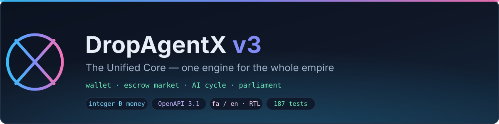
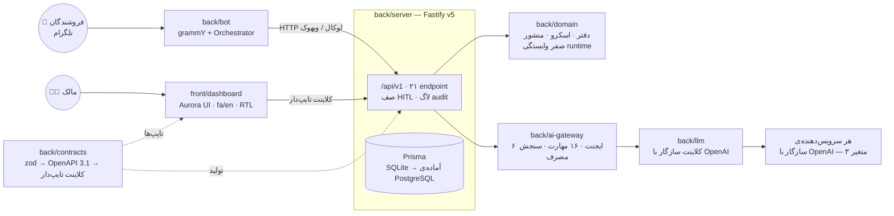

<div align="center">



**یک موتور برای کل امپراتوری — دفتر کیف پول، مارکت‌پلیس اسکرو، چرخه‌ی AI و پارلمان؛
این بار از روز صفر با معماری دامنه‌محور بازنویسی شده.**

`front/` → داشبورد Aurora · `back/` → سرور، ربات و همه‌ی بسته‌های دامنه

[](package.json)
[](.github/workflows/ci.yml)
[](#تست‌ها)
[](tsconfig.base.json)
[](package.json)
[](pnpm-workspace.yaml)
[](LICENSE)

**[English](README.md)** · **[فارسی](README.fa.md)** · [معماری](docs/ARCHITECTURE.md) · [نقشه‌ی راه](docs/ROADMAP.md) · [انتشار](docs/DEPLOY.md) · [تز محصول](docs/PRODUCT-THESIS.md) · [ADRها](docs/adr/)

</div>

---

## چرا این پروژه وجود دارد؟

پنج ابزار جدای از هم — اینجا یک کیف پول، آن‌جا یک فروشگاه، یک چت‌بات AI در حاشیه —
در هر درز، پول و اعتماد نشت می‌دادند. **نسخه‌ی ۳ همه‌ی آن‌ها را در یک موتور جمع می‌کند**
با یک منبع حقیقت واحد:

| ماژول | کاری که می‌کند | کجا زندگی می‌کند |
|---|---|---|
| 💰 **کیف پول (Đ)** | دفتر دوطرفه با ارز صحیح، تراکنش‌های تغییرناپذیر، mint/burn/خزانه/مالیات | `back/domain` + `back/server` |
| 🏪 **مارکت اسکرو** | ماشین حالت صریح ۸ حالته — هر فروش از مسیر اسکرو می‌گذرد: fund → deliver → release | `back/domain` + `back/server` |
| 🤖 **چرخه‌ی AI** | ۶ ایجنت Zenovix + ۱۶ مهارت KIA-OS پشت یک گیت‌وی سازگار با OpenAI، با سنجش مصرف و سقف | `back/ai-gateway` + `back/llm` |
| ⚖️ **پارلمان / HITL** | هر عملیات بالای ۵۰٬۰۰۰ Đ منتظر تصمیم انسانی می‌ماند — sweep، تأیید، رد | `back/server` + `back/bot` |
| 🖥️ **داشبورد Aurora** | دوزبانه fa/en، راست‌به‌چپ بومی، با کلاینت تایپ‌دار مستقیماً روی قراردادهای API | `front/dashboard` |

همین بازنویسی، چیزهایی که نسخه‌ی ۲ را قابل‌اعتماد می‌کرد حفظ کرده — قراردادهای تایپ‌دار،
امنیت fail-closed و نظم انتشار — و هرچه تغییرش را سخت می‌کرد دور انداخته.

## معماری



- **قراردادها تک‌منبع حقیقت‌اند.** هر endpoint فقط یک‌بار به‌صورت اسکیمای zod در
  [`back/contracts`](back/contracts/src) تعریف می‌شود؛ سند OpenAPI 3.1، مستندات مرورپذیر
  و کلاینتِ داشبورد همه از همان ساخته می‌شوند.
- **دامنه صفر وابستگی runtime دارد.** پول، دفتر، اسکرو و منشور توابع خالص‌اند —
  لایه‌ی HTTP فقط یک آداپتور نازک روی آن‌هاست.

## ساختار پروژه

```
DropAgentX v3
├── front/                    # هرچه کاربر لمس می‌کند
│   └── dashboard/            # Aurora UI — React 19 + Vite + Tailwind v4، fa/en
├── back/                     # هرچه موتور اجرا می‌کند
│   ├── server/               # Fastify v5 + Prisma · /api/v1 · HITL · اسکریپت‌های مهاجرت
│   ├── bot/                  # ربات تلگرام (grammY) · صف HITL در جیب شما
│   ├── domain/               # 💎 هسته‌ی خالص: پول، دفتر دوطرفه، اسکرو، منشور
│   ├── contracts/            # قراردادهای zod → OpenAPI 3.1 → کلاینت تایپ‌دار
│   ├── llm/                  # کلاینت سازگار با OpenAI (ADR-006)
│   └── ai-gateway/           # ۶ ایجنت · ۱۶ مهارت · fallback قطعی · سقف مصرف
├── docs/                     # تز، معماری، نقشه‌ی راه، انتشار + ۸ سند ADR
├── scripts/                  # آیین QC انتشار (package-v3.sh)
├── Dockerfile                # ایمیج سرویس واحد (server + bot در یک process)
└── railway.json              # کانفیگ انتشار Railway — healthcheck روی /api/v1/health
```

## قانون‌های مقدس

غیرقابل‌مذاکره — با تست تضمین شده‌اند، نه با امید:

- 🧾 **پول همیشه عدد صحیح است** (`Din` brand) — هیچ float ای وارد دامنه نمی‌شود.
- ⚖️ **دفتر دوطرفه و تغییرناپذیر است** — Σ همه‌ی ترازها همیشه صفر؛ ترازها مشتق (derived) هستند، ذخیره نمی‌شوند.
- 📮 **قواعد جهت fail-closed هستند** — mint هرگز منفی نمی‌شود، burn هرگز مثبت نمی‌شود،
  حساب‌های user/escrow/خزانه هرگز منفی نمی‌شوند.
- 🏪 **هر فروش مارکتی از اسکرو می‌گذرد** — ماشین حالت صریح ۸ حالته:
  `CREATED → FUNDED → DELIVERED → RELEASED`، `DISPUTED → REFUNDED | RELEASED`،
  `CANCELLED`، `EXPIRED`.
- 🔁 **کلیدهای idempotency به‌صورت no-op پخش می‌شوند** — همان تراکنش دو بار؟ امن است.
- 🧑‍⚖️ **عملیات ≥ ۵۰٬۰۰۰ Đ نیاز به تأیید انسانی دارد (HITL)** — هم در تلگرام، هم در داشبورد.
- 🧱 **خطاها مقدار `Result` هستند** — هیچ exception از مرز دامنه عبور نمی‌کند.
- 🔐 **اسرار هرگز وارد git نمی‌شوند** — ریپو یک `.env` خالی توزیع می‌کند؛ هر انتشار کلیدهای خودش را می‌سازد.

## شروع سریع

**پیش‌نیازها:** Node ≥ 22، [pnpm 9](https://pnpm.io) (با corepack)، داکر اختیاری.

```bash
git clone https://github.com/KiaAgentX/DropAgentX-v3.git dropagentx-v3
cd dropagentx

pnpm install            # نصب workspace (۷ بسته)
cp .env.example .env    # بعد DATABASE_URL و KIA_ADMIN_KEY را پر کنید

pnpm test               # ۱۸۷ تست در ۷ بسته
pnpm typecheck          # strict، صفر خطا

pnpm -F @dropagentx/server dev        # API روی :8787 — مستندات در /api/v1/docs
pnpm -F @dropagentx/dashboard dev     # داشبورد روی :5173
pnpm -F @dropagentx/bot dev           # ربات تلگرام در حالت polling
```

حداقلی‌ترین `.env`:

```ini
DATABASE_URL=file:./db/v3.db          # SQLite (اسکیما آماده‌ی PostgreSQL)
KIA_ADMIN_KEY=<openssl rand -hex 24>  # هدر X-KIA-Key برای ادمین و داشبورد

TELEGRAM_BOT_TOKEN=                   # اختیاری — انتشار بدون ربات خالی بماند
OPENAI_BASE_URL=                      # لایه‌ی AI: هر سه با هم، یا هیچ‌کدام
OPENAI_API_KEY=                       # (ADR-006)
MODEL=
```

### یک پروسه، یک انتشار

در Railway (یا داکر) سرور و ربات در **یک پروسه** اجرا می‌شوند — ربات از طریق loopback
با همان احراز هویت هر کلاینت با API حرف می‌زند:

```bash
docker build -t dropagentx-v3 .
docker run --rm -p 8787:8787 --env-file .env dropagentx-v3
```

Railway: ریپو را push کنید، یک volume روی `/app/db` وصل کنید و متغیرهای محیطی را از
[`docs/DEPLOY.md`](docs/DEPLOY.md) بگذارید — `railway.json` و healthcheck
(`/api/v1/health`) از قبل سیم‌کشی شده‌اند.

## سطح API

۲۱ endpoint تایپ‌دار زیر `/api/v1`، همه از قراردادهای zod ساخته شده‌اند — سند زنده‌ی
OpenAPI روی **`/api/v1/openapi.json`** و مستندات مرورپذیر روی **`/api/v1/docs`**:

| گروه | endpoint ها | توضیح |
|---|---|---|
| Meta | `GET /health` · `GET /openapi.json` · `GET /docs` | healthcheck برای Railway |
| کیف پول | `POST /wallet/mint` · `POST /wallet/burn` | قواعد جهت fail-closed |
| حساب‌ها | `GET /accounts` | ترازهای derived، نما‌ی trial balance |
| اسکرو | `GET /escrows` + مسیرهای چرخه‌ی عمر | ماشین ۸ حالته، idempotent |
| HITL | `GET /hitl` · `POST /hitl/sweep` | صف ≥ ۵۰٬۰۰۰ Đ |
| اقتصاد | `GET /economy` | عرضه در گردش، خزانه، مالیات |
| AI | `POST /ai/chat` · `GET /ai/agents` · `GET /ai/skills` · `GET /ai/usage` | سنجیده، سقف‌دار |
| ربات | `POST /bot/webhook` | در حالت سرویس واحد خودکار مسلح می‌شود |

هر پاسخ با همان اسکیمایی که مسیر را ساخته اعتبارسنجی می‌شود — کلاینت تایپ‌دار داشبورد
([`createV3Client`](front/dashboard/src/lib/api.ts)) همان بسته‌ی قرارداد را با سرور به اشتراک می‌گذارد.

## لایه‌ی AI — سازگار با OpenAI، از طراحی

[ADR-006](docs/adr/ADR-006-openai-compatible-llm.md) لایه‌ی مدل را به **یک قرارداد** قفل
کرده: یک API ساده‌ی سازگار با OpenAI. بدون SDK اختصاصی، بدون قفل به فروشنده —
تغییر سرویس‌دهنده فقط با سه متغیر محیطی:

```ini
OPENAI_BASE_URL=https://your-provider.example/v1
OPENAI_API_KEY=sk-...
MODEL=your-model-of-choice
```

روی همین کلاینتِ واحد، [`back/ai-gateway`](back/ai-gateway/src) **۶ ایجنت Zenovix**
(`orchestrator`، `receptionist`، `sales`، `support`، `analyst`، `content`) و
**۱۶ مهارت KIA-OS** (کیف پول، اسکرو، محصولات، پایگاه دانش، آنالیتیکس، اطلاع‌رسانی)
را اجرا می‌کند — با سقف توکن روزانه برای هر کاربر، سنجش مصرف و fallback قطعی وقتی
سرویس‌دهنده در دسترس نیست. سرویس‌دهنده‌ی دوم (`OPENAI_BASE_URL_2` / `OPENAI_API_KEY_2` /
`MODEL_2`) می‌تواند به‌عنوان fallback همراه باشد.

## مدل امنیتی

- **احراز تلگرام** — هر درخواست ربات با امضای HMAC روی `initData` در برابر توکن ربات
  راستی‌آزمایی می‌شود؛ payload جعلی رد می‌شود.
- **سطح ادمین** — مسیرهای مدیریتی هدر `X-KIA-Key` می‌خواهند؛ مقایسه به‌صورت
  timing-safe با `KIA_ADMIN_KEY`.
- **محدودیت نرخ** — throttle بر اساس IP با `@fastify/rate-limit` (پیش‌فرض ۲۴۰ درخواست/دقیقه).
- **لاگ audit** — رویدادهای امنیتی در یک دفتر append-only ثبت می‌شوند.
- **Fail-closed** — احراز هویت گم‌شده یا خراب یعنی رد، نه حدس.
- **آستانه‌ی انسانی** — HITL مبالغ غیرقابل‌برگشت را زیر کنترل انسانی نگه می‌دارد.

## مهاجرت لجسی

داده‌ی v2 از روز اول به v3 می‌آید، به‌صورت replay-safe: ۴۶۶ کاربر روی حساب‌های
`user:tg:<id>` می‌نشینند و گپ تاریخی −۶۳ Đ به‌صورت **ردیف تعدیل صریح** می‌شود —
هرگز یک تعمیر بی‌صدا. ممیزی بیرونی است (SQL خام، بدون Prisma):

```bash
pnpm -F @dropagentx/server exec tsx scripts/migrate-legacy.ts --from <v2.json> --db file:./db/v3.db
pnpm -F @dropagentx/server exec tsx scripts/genesis-proof.ts --db file:./db/v3.db
# PROOF OK — Σ کیف‌های کاربران = ۱۸۷٬۶۷۲ Đ، همه‌ی انتظارها برقرار.
```

## تست‌ها

۱۸۷ تست، سبز در CI روی هر push:

| بسته | تعداد | پوشش |
|---|---:|---|
| `back/domain` | ۴۰ | پول، بستگی دفتر، ماشین اسکرو، منشور |
| `back/server` | ۳۵ | HTTP + امنیت + HITL + چرخه‌ی AI (انتگراسیون) |
| `front/dashboard` | ۳۵ | UI، i18n، فرمت‌بندی، **roundtrip کلاینت↔سرور** |
| `back/ai-gateway` | ۲۹ | ایجنت‌ها، مهارت‌ها، سنجش، fallback |
| `back/bot` | ۲۰ | Orchestrator + چسب تلگرام |
| `back/llm` | ۱۷ | قرارداد کلاینت سازگار با OpenAI |
| `back/contracts` | ۱۱ | تولید OpenAPI + کلاینت تایپ‌دار |

تست roundtrip داشبورد **سرور واقعی** را روی دیتابیس موقت بالا می‌آورد و **کلاینت
تایپ‌دار واقعی** را از میانش عبور می‌دهد — قراردادها سر تا سر تمرین می‌شوند، نه mock.

## نقشه‌ی راه

| فاز | محتوا | وضعیت |
|---|---|---|
| ۰ | اسکلت monorepo — pnpm + turbo + TS strict + CI | ✅ |
| ۱ | هسته‌ی دامنه‌ی خالص — پول، دفتر، اسکرو، منشور | ✅ |
| ۲ | سرور Fastify + قراردادهای zod→OpenAPI + کلاینت LLM | ✅ |
| ۳ | ربات تلگرام (grammY) + HITL سمت سرور | ✅ |
| ۴ | داشبورد Aurora — fa/en، RTL، کلاینت تایپ‌دار | ✅ |
| ۵ | گیت‌وی AI — ۶ ایجنت، ۱۶ مهارت، سقف، fallback | ✅ |
| ۶ | مهاجرت لجسی (Σ ۱۸۷٬۶۷۲ Đ اثبات‌شده) + انتشار Railway | ✅ |

جزئیات و معیارهای پذیرش هر فاز: [`docs/ROADMAP.md`](docs/ROADMAP.md).
تصمیم‌ها و پیامدهایشان: [`docs/adr/`](docs/adr/) (ADR-001 تا ADR-008).

## مستندات

| سند | چه چیزی داخلش است |
|---|---|
| [PRODUCT-THESIS.md](docs/PRODUCT-THESIS.md) | چرا این موتور فروش می‌رود — ۵ ابزار شکسته → ۱، سه لایه درآمد |
| [ARCHITECTURE.md](docs/ARCHITECTURE.md) | چیدمان شش‌ضلعی، جریان داده، مرز ماژول‌ها |
| [ROADMAP.md](docs/ROADMAP.md) | فازها با معیار پذیرش |
| [DEPLOY.md](docs/DEPLOY.md) | انتشار سرویس واحد Railway، volume، ران‌بوک مهاجرت |
| [ADR-001…008](docs/adr/) | اسناد تصمیم معماری — شش‌ضلعی، پول صحیح، دوطرفه، ماشین اسکرو، قرارداد/OpenAPI، LLM سازگار با OpenAI، Vite SPA، گیت‌وی AI |

## مشارکت

این خط تولیدِ یک محصول تجاری است، پس قواعد سخت‌گیرانه‌اند:

1. از `main` **شاخه بگیرید**؛ کامیت‌ها [سبک conventional](https://www.conventionalcommits.org) (`feat:`، `fix:`، `docs:`…).
2. **typecheck + تست باید سبز بماند** — `pnpm typecheck && pnpm test` قبل از هر push (CI اجبارش می‌کند).
3. **هر تغییر دامنه برای هر قانون مقدسی که لمس می‌کند تست می‌خواهد.**
4. **هرگز اسرار را commit نکنید** — آیین QC هر کلید واقعی‌نما در قالب‌های env را رد می‌کند.

آیین انتشار (`scripts/package-v3.sh`) حاضر نیست چیزی بفرستد مگر اینکه درخت تمیز باشد،
`git fsck` بگذرد، هر ۱۸۷ تست سبز باشند، نسخه‌ی همه‌ی بسته‌ها یکسان باشد و هیچ اسری
به قالب env نشت نکرده باشد.

## مجوز

[MIT](LICENSE) © KiaAgentX

<div align="center">

<sub>«از صفر و یک، تا حکومت.»</sub>

</div>
