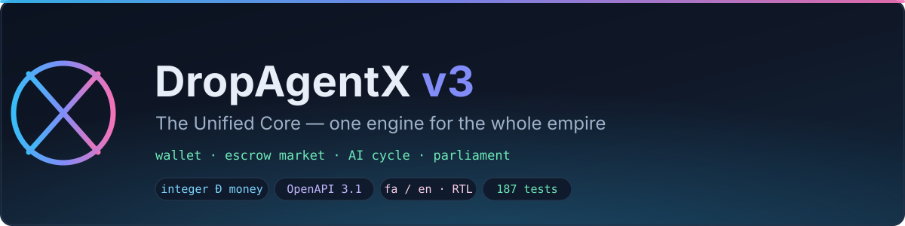
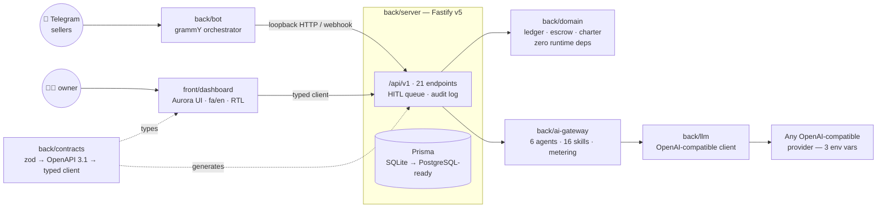

<div align="center">



**One engine for the whole empire — wallet ledger, escrow marketplace, AI cycle and parliament, rebuilt domain-first from day zero.**

`front/` → Aurora dashboard · `back/` → server, bot and every domain package

[](package.json)
[](.github/workflows/ci.yml)
[](#testing)
[](tsconfig.base.json)
[](package.json)
[](pnpm-workspace.yaml)
[](LICENSE)

**[English](README.md)** · **[فارسی](README.fa.md)** · [Architecture](docs/ARCHITECTURE.md) · [Roadmap](docs/ROADMAP.md) · [Deploy](docs/DEPLOY.md) · [Product Thesis](docs/PRODUCT-THESIS.md) · [ADRs](docs/adr/)

</div>

---

## Why this exists

Five disconnected tools — a wallet here, a shop there, an AI chatbot on the side —
were leaking money and trust at every seam. **v3 collapses them into one engine**
with a single source of truth:

| Module | What it does | Where it lives |
|---|---|---|
| 💰 **Wallet (Đ)** | Integer-currency double-entry ledger, immutable postings, mint/burn/treasury/tax | `back/domain` + `back/server` |
| 🏪 **Escrow market** | Explicit 8-state machine — every sale funds, delivers, releases (or refunds) through escrow | `back/domain` + `back/server` |
| 🤖 **AI cycle** | 6 Zenovix agents + 16 KIA-OS skills behind one OpenAI-compatible gateway, with metering and caps | `back/ai-gateway` + `back/llm` |
| ⚖️ **Parliament / HITL** | Any operation ≥ 50,000 Đ waits for a human decision — sweep, approve, reject | `back/server` + `back/bot` |
| 🖥️ **Aurora dashboard** | fa/en bilingual, RTL-native, typed straight against the API contracts | `front/dashboard` |

The same rewrite keeps what made v2 trustworthy — typed contracts, fail-closed
security, release discipline — and drops everything that made it hard to change.

## Architecture



- **Contracts are the single point of truth.** Every endpoint is declared once as a
  zod schema in [`back/contracts`](back/contracts/src); the OpenAPI 3.1 document, the
  browsable docs and the client used by the dashboard are all derived from it.
- **The domain has zero runtime dependencies.** Money, ledger, escrow and charter are
  pure functions — the HTTP layer is a thin adapter around them.

## Project layout

```
DropAgentX v3
├── front/                    # everything the user touches
│   └── dashboard/            # Aurora UI — React 19 + Vite + Tailwind v4, fa/en
├── back/                     # everything the engine runs
│   ├── server/               # Fastify v5 + Prisma · /api/v1 · HITL · migration scripts
│   ├── bot/                  # Telegram bot (grammY) · HITL queue in your pocket
│   ├── domain/               # 💎 pure core: money, double-entry ledger, escrow, charter
│   ├── contracts/            # zod contracts → OpenAPI 3.1 → typed client
│   ├── llm/                  # OpenAI-compatible client (ADR-006)
│   └── ai-gateway/           # 6 agents · 16 skills · deterministic fallback · caps
├── docs/                     # thesis, architecture, roadmap, deploy + 8 ADRs
├── scripts/                  # release QC ritual (package-v3.sh)
├── Dockerfile                # single-service image (server + bot in one process)
└── railway.json              # Railway deploy config — healthcheck on /api/v1/health
```

## The sacred rules

Non-negotiables enforced by tests, not by hope:

- 🧾 **Money is always an integer** (`Din` brand) — no float ever enters the domain.
- ⚖️ **The ledger is double-entry and immutable** — Σ of all balances is always 0;
  balances are derived, never stored.
- 📮 **Direction rules fail closed** — mint can never be negative, burn can never be
  positive, user/escrow/treasury accounts can never go negative.
- 🏪 **Every market sale goes through escrow** — an explicit 8-state machine:
  `CREATED → FUNDED → DELIVERED → RELEASED`, `DISPUTED → REFUNDED | RELEASED`,
  `CANCELLED`, `EXPIRED`.
- 🔁 **Idempotency keys replay as no-ops** — the same transaction twice is safe.
- 🧑‍⚖️ **Operations ≥ 50,000 Đ require human approval (HITL)** — in Telegram and on the dashboard.
- 🧱 **Errors are `Result` values** — no exception ever crosses the domain boundary.
- 🔐 **Secrets never enter git** — the repo ships an empty `.env`; each deployment generates its own keys.

## Quickstart

**Prerequisites:** Node ≥ 22, [pnpm 9](https://pnpm.io) (via corepack), optional Docker.

```bash
git clone https://github.com/KiaAgentX/DropAgentX.git dropagentx
cd dropagentx

pnpm install            # workspace install (7 packages)
cp .env.example .env    # then fill DATABASE_URL + KIA_ADMIN_KEY (see below)

pnpm test               # 187 tests across 7 packages
pnpm typecheck          # strict, zero errors

pnpm -F @dropagentx/server dev        # API on :8787 — docs at /api/v1/docs
pnpm -F @dropagentx/dashboard dev     # dashboard on :5173
pnpm -F @dropagentx/bot dev           # Telegram bot in polling mode
```

Minimum viable `.env`:

```ini
DATABASE_URL=file:./db/v3.db          # SQLite (schema is PostgreSQL-ready)
KIA_ADMIN_KEY=<openssl rand -hex 24>  # the X-KIA-Key header for admin + dashboard

TELEGRAM_BOT_TOKEN=                   # optional — server-only deployments leave it blank
OPENAI_BASE_URL=                      # the AI layer: all three together, or none
OPENAI_API_KEY=                       # (ADR-006)
MODEL=
```

### One process, one deploy

On Railway (or Docker) the server and the bot run in **one process** — the bot talks
to the API over loopback with the same auth as any client:

```bash
docker build -t dropagentx-v3 .
docker run --rm -p 8787:8787 --env-file .env dropagentx-v3
```

Railway: push the repo, attach a volume at `/app/db`, set the env vars from
[`docs/DEPLOY.md`](docs/DEPLOY.md) — `railway.json` and the healthcheck
(`/api/v1/health`) are already wired.

## API surface

21 typed endpoints under `/api/v1`, all generated from zod contracts — the live
OpenAPI document is served at **`/api/v1/openapi.json`**, browsable docs at **`/api/v1/docs`**:

| Group | Endpoints | Notes |
|---|---|---|
| Meta | `GET /health` · `GET /openapi.json` · `GET /docs` | healthcheck for Railway |
| Wallet | `POST /wallet/mint` · `POST /wallet/burn` | direction rules fail closed |
| Accounts | `GET /accounts` | derived balances, trial balance view |
| Escrow | `GET /escrows` + lifecycle routes | 8-state machine, idempotent |
| HITL | `GET /hitl` · `POST /hitl/sweep` | ≥ 50,000 Đ queue |
| Economy | `GET /economy` | circulating supply, treasury, tax |
| AI | `POST /ai/chat` · `GET /ai/agents` · `GET /ai/skills` · `GET /ai/usage` | metered, capped |
| Bot | `POST /bot/webhook` | armed automatically in single-service mode |

Every response is validated against the same schema that generated the route —
the dashboard's typed client ([`createV3Client`](front/dashboard/src/lib/api.ts))
shares the contract package with the server.

## The AI layer — OpenAI-compatible by design

[ADR-006](docs/adr/ADR-006-openai-compatible-llm.md) locks the model layer to **one
contract**: a plain OpenAI-compatible API. No vendor SDK, no lock-in — swap providers
by changing three environment variables:

```ini
OPENAI_BASE_URL=https://your-provider.example/v1
OPENAI_API_KEY=sk-...
MODEL=your-model-of-choice
```

On top of that single client, [`back/ai-gateway`](back/ai-gateway/src) runs **6 Zenovix
agents** (`orchestrator`, `receptionist`, `sales`, `support`, `analyst`, `content`) and
**16 KIA-OS skills** (wallet, escrow, products, knowledge base, analytics, notifications),
with per-user daily token caps, usage metering and deterministic fallback when the
provider is unreachable. A second provider (`OPENAI_BASE_URL_2` / `OPENAI_API_KEY_2` /
`MODEL_2`) can ride along as fallback.

## Security model

- **Telegram auth** — every bot request is verified with the `initData` HMAC
  signature against the bot token; spoofed payloads are rejected.
- **Admin surface** — management routes require the `X-KIA-Key` header, compared
  timing-safe against `KIA_ADMIN_KEY`.
- **Rate limiting** — per-IP throttling via `@fastify/rate-limit` (default 240 req/min).
- **Audit log** — security-relevant events land in an append-only trail.
- **Fail-closed** — missing or malformed auth is a rejection, never a guess.
- **Human threshold** — HITL keeps irreversible amounts under human control.

## Legacy migration

v2 data moves into v3 on day one, replay-safe: 466 users land on `user:tg:<id>`
accounts, and the historical −63 Đ gap becomes an **explicit adjustment row** —
never a silent fix. The audit is external (raw SQL, no Prisma):

```bash
pnpm -F @dropagentx/server exec tsx scripts/migrate-legacy.ts --from <v2.json> --db file:./db/v3.db
pnpm -F @dropagentx/server exec tsx scripts/genesis-proof.ts --db file:./db/v3.db
# PROOF OK — Σ user wallets = 187,672 Đ, every expectation holds.
```

## Testing

187 tests, green in CI on every push:

| Package | Tests | Covers |
|---|---:|---|
| `back/domain` | 40 | money, ledger closure, escrow machine, charter |
| `back/server` | 35 | HTTP + security + HITL + AI cycle integration |
| `front/dashboard` | 35 | UI, i18n, formatting, **client↔server roundtrip** |
| `back/ai-gateway` | 29 | agents, skills, metering, fallback |
| `back/bot` | 20 | orchestrator + Telegram glue |
| `back/llm` | 17 | OpenAI-compatible client contract |
| `back/contracts` | 11 | OpenAPI generation + typed client |

The dashboard roundtrip test boots the **real server** on a temp database and drives
the **real typed client** through it — contracts are exercised end-to-end, not mocked.

## Roadmap

| Phase | Scope | Status |
|---|---|---|
| 0 | Monorepo skeleton — pnpm + turbo + TS strict + CI | ✅ |
| 1 | Pure domain core — money, ledger, escrow, charter | ✅ |
| 2 | Fastify server + zod→OpenAPI contracts + LLM client | ✅ |
| 3 | Telegram bot (grammY) + server-side HITL | ✅ |
| 4 | Aurora dashboard — fa/en, RTL, typed client | ✅ |
| 5 | AI gateway — 6 agents, 16 skills, caps, fallback | ✅ |
| 6 | Legacy migration (Σ 187,672 Đ proven) + Railway release | ✅ |

Details and acceptance criteria per phase: [`docs/ROADMAP.md`](docs/ROADMAP.md).
Decisions and their consequences: [`docs/adr/`](docs/adr/) (ADR-001 → ADR-008).

## Documentation

| Doc | What's inside |
|---|---|
| [PRODUCT-THESIS.md](docs/PRODUCT-THESIS.md) | why this engine sells — 5 broken tools → 1, three revenue layers |
| [ARCHITECTURE.md](docs/ARCHITECTURE.md) | hexagonal layout, data flow, module boundaries |
| [ROADMAP.md](docs/ROADMAP.md) | phases with acceptance criteria |
| [DEPLOY.md](docs/DEPLOY.md) | Railway single-service deploy, volume, migration runbook |
| [ADR-001…008](docs/adr/) | architecture decision records — hexagonal, integer money, double entry, escrow machine, contracts/OpenAPI, OpenAI-compatible LLM, Vite SPA, AI gateway |

## Contributing

This is the production line for a commercial product, so the rules are strict:

1. **Branch** off `main`, keep commits in [conventional style](https://www.conventionalcommits.org) (`feat:`, `fix:`, `docs:`…).
2. **Typecheck + tests must stay green** — `pnpm typecheck && pnpm test` before every push (CI enforces it).
3. **Domain changes need a test** for each sacred rule they touch.
4. **Never commit secrets** — the QC ritual rejects any real-looking key in env templates.

The release ritual (`scripts/package-v3.sh`) refuses to ship unless the tree is
clean, `git fsck` passes, all 187 tests are green, every workspace version matches,
and no secret has leaked into the env template.

## License

[MIT](LICENSE) © KiaAgentX

<div align="center">

<sub>«از صفر و یک، تا حکومت.» — <i>From zero and one, to sovereignty.</i></sub>

</div>
